# Directorio Dolores Hidalgo: TDD y API

## 1. Pruebas de Cliente y Seguridad

Rojo: las pruebas iniciales del cliente HTTP y seguridad fallan.

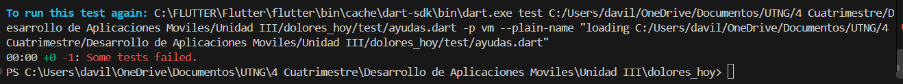

### Cliente Falso y Cliente Seguro

Rojo: la prueba del cliente falso y el cliente seguro falla porque aún no están implementadas las validaciones.

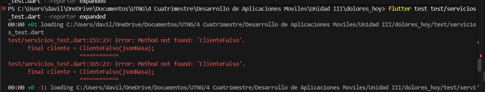
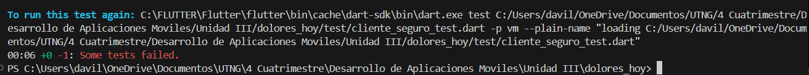

Verde: se implementa el cliente seguro y la prueba pasa.

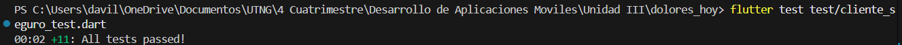

### Seguridad General

Rojo: la prueba de seguridad general falla.

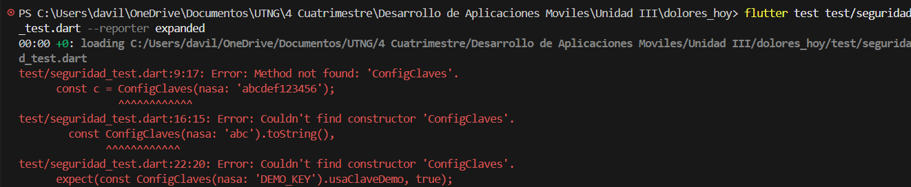

Verde: se implementan las políticas de seguridad y la prueba pasa.

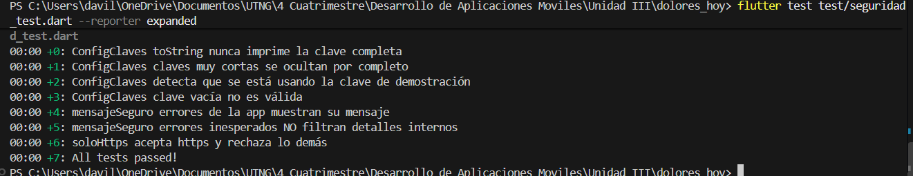

---

## 2. Pruebas de Servicios (APIs)

Rojo: las pruebas de integración de los servicios fallan porque aún no se han desarrollado.

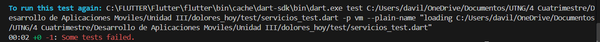

Verde: se implementan los servicios y las pruebas pasan.

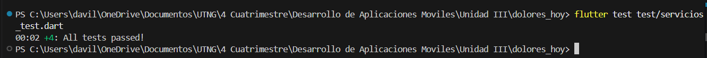

### Iteraciones de Servicios

Rojo: las pruebas de las iteraciones avanzadas fallan.

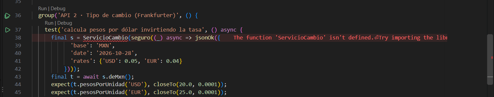
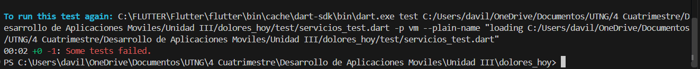
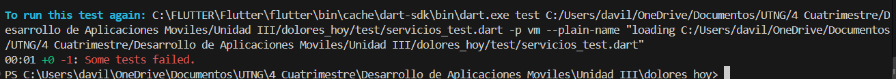

Verde: se completan las iteraciones y las pruebas pasan exitosamente.

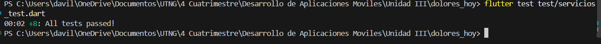
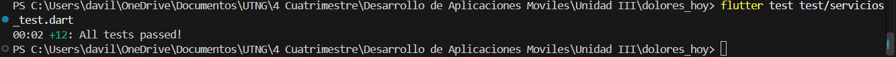

### API NASA

Verde: la prueba específica para la API de la NASA pasa correctamente.

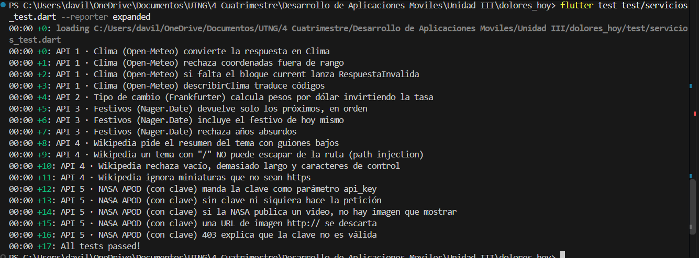

---

## 3. Tablero ViewModel (Gestión de Estados)

Rojo: la prueba de la secuencia de estados del ViewModel (cargando, error, datos) falla.

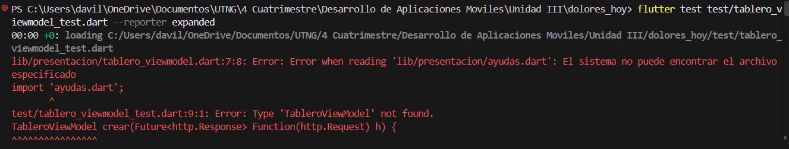

Verde: se implementa la gestión de estados en el ViewModel y la prueba pasa.

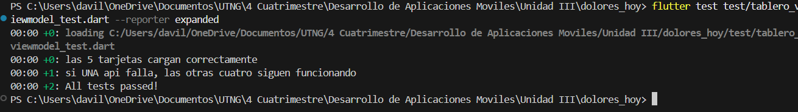

---

## 4. Vistas y Comportamiento en la Aplicación

Página funcionando: la aplicación carga correctamente los datos de las APIs.

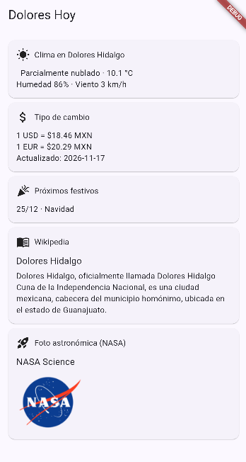

Todas funcionando: tablero completo consumiendo todas las APIs correctamente.

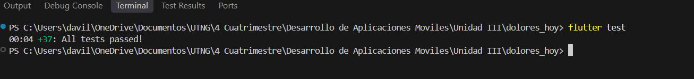

### Manejo de Errores y Red

Página sin internet: manejo adecuado de la excepción por falta de conectividad.

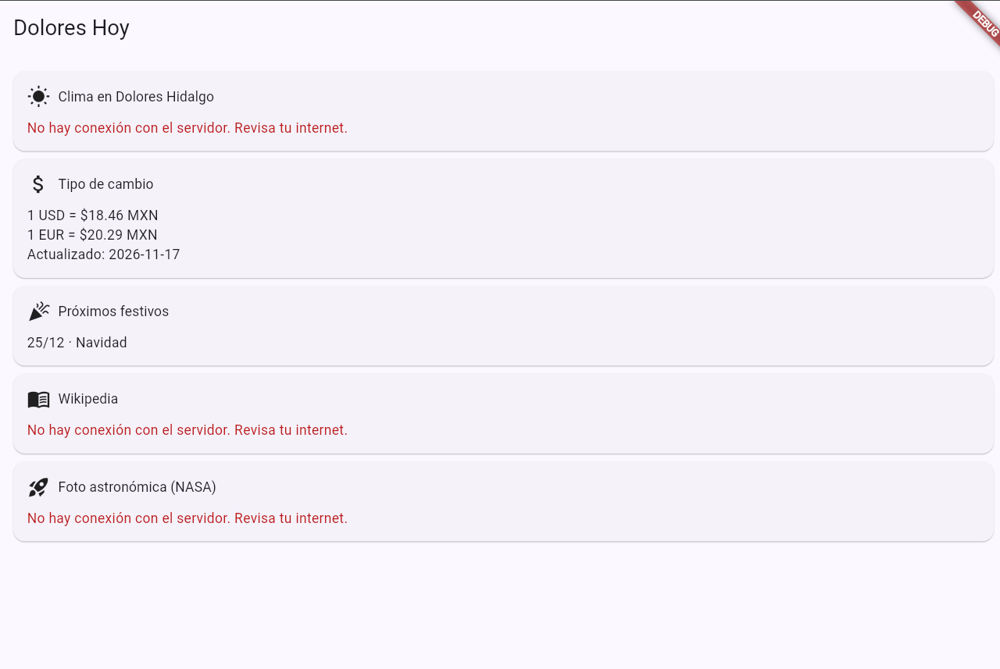

Página con error 403: manejo de respuestas de acceso denegado por parte del servidor.

